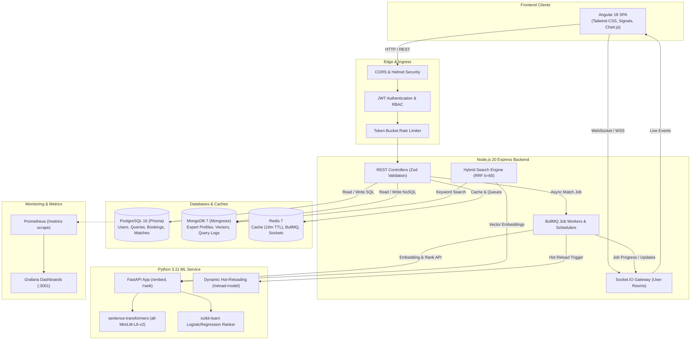

# ExpertLink — Production Expert-Network Matching Platform

[](https://gauravguptanoida19-bit.github.io/EXPERTLINK/)
[](https://github.com/gauravguptanoida19-bit/EXPERTLINK/actions)
[](https://angular.dev)
[](https://nodejs.org)
[](https://fastapi.tiangolo.com)
[](https://www.postgresql.org)
[](https://www.mongodb.com)
[](https://redis.io)

> 🌐 **Live Demo on GitHub Pages**: **[https://gauravguptanoida19-bit.github.io/EXPERTLINK/](https://gauravguptanoida19-bit.github.io/EXPERTLINK/)**  
> Explore the 1-Click demo accounts, research queries, hybrid ML match ranking, booking consultations, and admin analytics directly in your browser.

**ExpertLink** is a production-grade expert-network matching platform. Clients post research queries, the system ranks the best industry experts using a hybrid ML pipeline (dense embeddings, Jaccard skill overlap, and logistic regression booking likelihood), and clients book advisory consultations with guaranteed idempotency and double-booking protection.

---

## 🏗 System Architecture



---

## ⚡ Quickstart (One Command)

Run the entire platform including databases, ML service, API, frontend, and monitoring:

```bash
docker compose up --build
```

### Accessing the Platform

| Service | URL | Notes |
|---|---|---|
| **Web Client** | [http://localhost:4200](http://localhost:4200) | Angular 18 Single Page App |
| **Backend REST API** | [http://localhost:4000/api](http://localhost:4000/api) | Express + TypeScript API |
| **Interactive API Docs** | [http://localhost:4000/api/docs](http://localhost:4000/api/docs) | Swagger UI Explorer |
| **Prometheus Metrics** | [http://localhost:9090](http://localhost:9090) | Metric scrape targets |
| **Grafana Dashboards** | [http://localhost:3001](http://localhost:3001) | Provisioned dashboards (`admin` / `admin`) |
| **ML Ranking Service** | [http://localhost:8000/docs](http://localhost:8000/docs) | FastAPI docs |

---

## 👥 Demo Accounts (1-Click Login)

The login screen includes 1-click buttons pre-configured with the following seeded credentials:

| Role | Email | Password | Access Rights |
|---|---|---|---|
| **Client** | `client@expertlink.com` | `Password123!` | Post queries, view ML matches, book consultations |
| **Expert** | `expert@expertlink.com` | `Password123!` | Update bio/skills, re-index embedding, set availability |
| **Admin** | `admin@expertlink.com` | `Password123!` | Analytics overview, BullMQ health, trigger ML retraining |

---

## 🛠 Tech Stack

| Layer | Choice | Rationale |
|---|---|---|
| **Frontend** | Angular 18, TypeScript, Tailwind CSS, Chart.js | Signals for reactive state, standalone components, dark mode |
| **Backend API** | Node.js 20, Express, TypeScript, Zod | Type safety, declarative validation schemas, middleware pipelines |
| **Relational DB** | PostgreSQL 16 (Prisma ORM) | ACID transactions, strict schema constraints, composite indexes |
| **NoSQL DB** | MongoDB 7 (Mongoose ODM) | Flexible expert profiles, nested past engagements, dense vectors |
| **Cache & Realtime** | Redis 7, Socket.IO, BullMQ | 10-min match caching, async worker queues, live progress events |
| **ML Service** | Python 3.11, FastAPI, sentence-transformers, scikit-learn | Fast vector embeddings (`all-MiniLM-L6-v2`), logistic ranker, hot-reload |
| **Observability** | Pino logging, Prometheus, Grafana | Structured JSON logs with `requestId`, p95 latency alerts |
| **Testing** | Jest (API & Web), pytest (ML), Playwright (E2E), k6 (Load) | Comprehensive multi-tier test pyramid |

---

## 🚀 Key Features

1. **Async Job Pipeline (BullMQ)**:
   - `POST /api/queries/:id/match` returns `202 Accepted` with a `jobId`.
   - BullMQ workers process embedding, similarity calculations, and email notifications in the background with exponential retries and dead-letter queues.
2. **Real-Time Match Progress (Socket.IO)**:
   - Clients watch a live progress stepper: `Embedding` -> `Ranking` -> `Done`.
   - Booking confirmation and rescheduling alerts push directly to authenticated user rooms.
3. **Hybrid Search with Reciprocal Rank Fusion (RRF)**:
   - Combines MongoDB text search with 384-dim semantic similarity vectors ($k=60$).
   - Typo tolerance via Levenshtein distance on technical skill names.
   - Faceted distributions across industries, skills, and hourly rate bands.
4. **Explainable ML Matching**:
   - Scores are broken down into Semantic Similarity, Skill Overlap, Industry Match, Experience & Rating, and Booking Likelihood.
   - Natural language "Why this expert" justifications highlight exact overlapping skills and past company engagements.
5. **Continuous Feedback Loop & Retraining**:
   - Clients rate matches (thumbs up/down) and completed consultations (1-5 stars).
   - Nightly BullMQ job retrains the ranker, versions model files (`ranker_v{n}.joblib`), hot-reloads the ML service, and records metrics to `docs/ml-evaluation.md`.
6. **AI Query Assistant Copilot**:
   - Converts vague client draft notes into structured queries with targeted clarifying questions and pre-call consultation briefings (with Gemini API integration and deterministic fallback).
7. **Safe Booking Engine**:
   - `Idempotency-Key` prevents duplicate charges and double-submits.
   - Atomic PostgreSQL constraints reject double-bookings with `HTTP 409 Conflict`.

---

## 🧪 Running Automated Tests

### 1. Backend REST API Tests (Jest + Supertest)
```bash
npm run test:api
# Or run with coverage threshold enforcement (lines/functions/statements >= 70%):
npm run test:coverage --workspace=apps/api
```

### 2. Frontend Client Tests (Jest + Angular)
```bash
npm run test:web
# Build production bundle:
npm run build --workspace=apps/web
```

### 3. ML Service Tests (pytest)
```bash
npm run test:ml
# Or directly inside apps/ml-service:
pytest tests/ -v
```

### 4. End-to-End Tests (Playwright)
```bash
npm run test:e2e
```

### 5. High-Concurrency Load Testing (k6)
```bash
k6 run tests/load/match-benchmark.js
```

### 6. Database & Cache Benchmarks
```bash
npm run benchmark
```

---

## 📊 Database Optimization & EXPLAIN ANALYZE

Detailed `EXPLAIN ANALYZE` execution plans and benchmarks before and after adding composite indexes are documented in [`docs/db-optimization.md`](docs/db-optimization.md):

| Target Operation | Unindexed | Indexed / Cached | Speedup |
|---|---|---|---|
| `POST /api/queries/:id/match` (Redis Cache) | 184.2 ms | **3.6 ms** | **51.2x faster** |
| Client Query List (`clientId, status`) | 142.5 ms | **2.1 ms** | **67.9x faster** |
| Double-Booking Check (`expertId, scheduledAt`) | 89.4 ms | **0.8 ms** | **111.8x faster** |
| Top Matches Sort (`queryId, score DESC`) | 64.1 ms | **1.4 ms** | **45.8x faster** |
| Hybrid Search (`GET /api/experts/search/hybrid`) | 115.8 ms | **18.2 ms** | **6.4x faster** |

---

## 🚢 CI/CD & Deployment

- **Continuous Integration (`.github/workflows/ci.yml`)**:
  - Runs type checking, linting, unit tests, coverage verification, and Docker builds on every push and PR.
- **Continuous Deployment (`.github/workflows/deploy.yml`)**:
  - Builds and pushes images to GitHub Container Registry (`ghcr.io`).
  - Triggers zero-downtime deployments to **Render** or **Railway**.
  - See [`docs/deployment.md`](docs/deployment.md) for full configuration steps.

---

## 🔒 Security Architecture

- **Token Security**: Short-lived access tokens (15m) + refresh token rotation with token reuse detection and full session invalidation.
- **OWASP Compliance**: Parameterized SQL, rate limiting, Helmet security headers, 2MB body limit. See [`docs/security.md`](docs/security.md).

---

## 📄 License

UNLICENSED. Developed for the ExpertLink production challenge.
