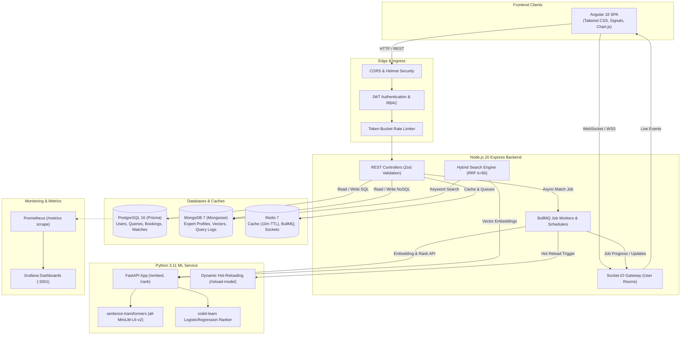

# ExpertLink System Architecture

ExpertLink is a production-grade expert-network matching platform designed to connect research clients with domain experts using semantic vector retrieval and machine learning ranking.

---

## 1. High-Level Architecture Diagram

---

## 2. Key Architecture Decisions

### 1. Dual-Database Paradigm (Polyglot Persistence)
- **PostgreSQL 16 (Prisma ORM)**:
  - System of record for ACID transactional entities: `User`, `Query`, `Match`, `Booking`, `RefreshToken`, `AuditLog`, `ConsultationFeedback`.
  - Composite indexes enforce double-booking prevention (`expertId, scheduledAt`) and query matching speed (`queryId, score DESC`).
- **MongoDB 7 (Mongoose ODM)**:
  - Flexible schema for dynamic semi-structured profiles: `ExpertProfile` (bio, variable skills, years of experience, nested past engagements history, and 384-dimensional dense semantic vectors).
  - High-throughput logging via `QueryLog` for timing analytics and audit trails.

### 2. Machine Learning Matching & Ranking Engine
- **Representation**: `sentence-transformers/all-MiniLM-L6-v2` produces 384-dimensional dense unit-normalized semantic embeddings.
- **Scoring Pipeline**:
  - **Cosine Similarity**: Semantic alignment between client problem description and expert background.
  - **Jaccard Similarity**: Exact technical skill set intersection.
  - **Industry Categorization Match**: Binary / weighted alignment.
  - **Experience & Rating**: Normalized track-record score.
  - **Logistic Regression Classifier**: Trained on historical booking conversion and client relevance ratings.
- **Explainability**: Every match card returns per-factor sub-scores and human-readable justification summaries.

### 3. Asynchronous BullMQ Pipelines
- Heavy workloads (query embedding, ML candidate ranking, notification delivery, model retraining) are offloaded to Redis-backed queues.
- `POST /api/queries/:id/match` immediately returns `202 Accepted` with a `jobId`.
- Socket.IO gateway broadcasts real-time progress (`embedding` -> `ranking` -> `done`).

### 4. Reciprocal Rank Fusion (RRF) Hybrid Search
- Combines MongoDB text search scores with cosine semantic vector similarity.
- Typo tolerance via Levenshtein distance on skill names.
- Computes faceted distributions across industries, skills, and hourly rate bands.
